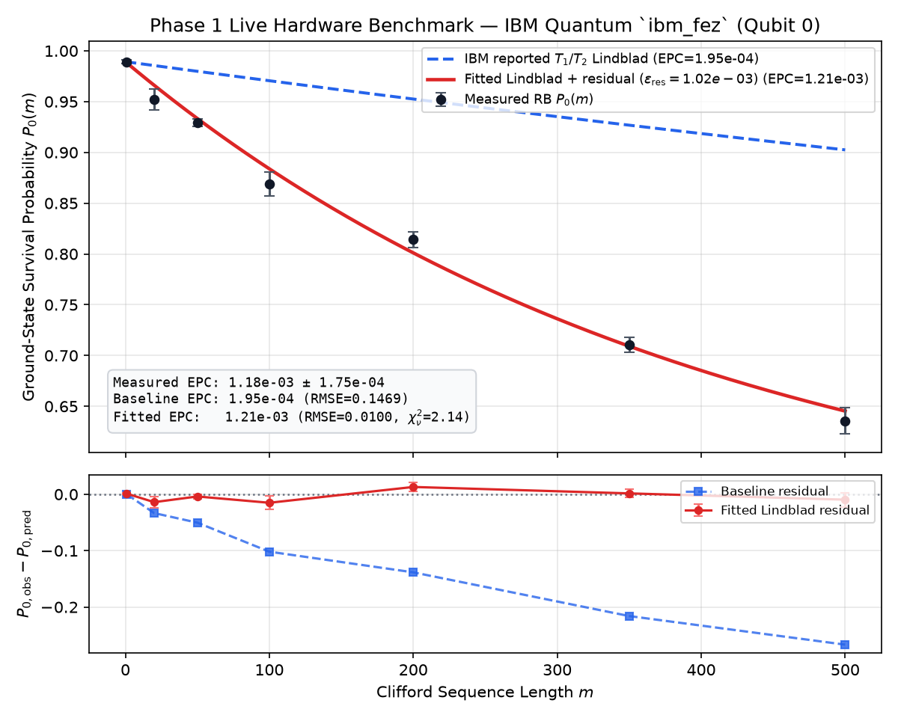
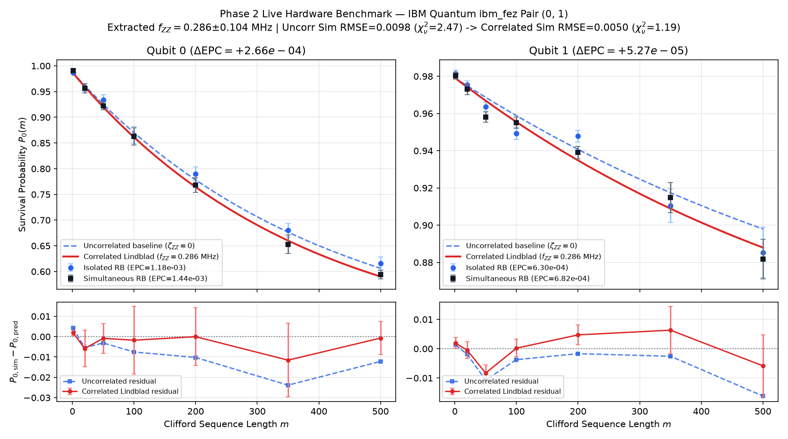
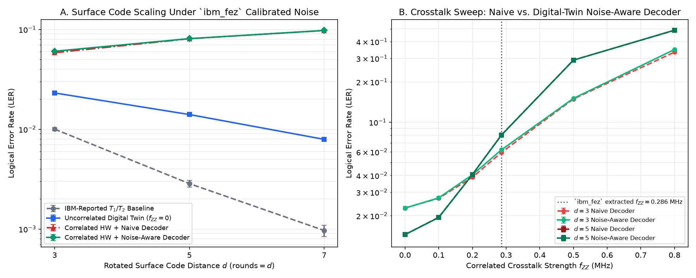

# qtwin

`qtwin` is a hardware-calibrated open-system Lindblad digital twin for superconducting quantum processors. It closes the loop from live IBM Heron (`ibm_fez`) Randomized Benchmarking (RB) and Simultaneous Randomized Benchmarking (SRB) measurements to Pauli-twirled circuit-level noise models for `stim` and `pymatching` rotated surface code simulations.

---

## Key Experimental Findings (`ibm_fez`)

All live hardware benchmarks were executed on the 156-qubit IBM Heron processor `ibm_fez` (free-tier `open-instance`) and verified against synthetic ground-truth simulations in `qiskit-aer`.

| Phase | Protocol / System | Measured Hardware Metric | Baseline Prediction | Fitted Digital Twin | Fit Quality / Impact |
| :--- | :--- | :--- | :--- | :--- | :--- |
| **Phase 1** | 1Q RB, Qubit 0 (`dc1umd2nj2vs73dfstig`) | $\mathrm{EPC} = 1.18 \times 10^{-3} \pm 1.75 \times 10^{-4}$ | IBM $T_1/T_2$ limit: $\mathrm{EPC} = 1.95 \times 10^{-4}$ (`RMSE = 0.1469`) | $\epsilon_{\mathrm{res}} = (1.02 \pm 0.27)\times 10^{-3}$, $\mathrm{EPC} = 1.21 \times 10^{-3}$ | 14.7x RMSE reduction (`0.0100`); $\chi^2_\nu: 377.46 \to 2.14$ |
| **Phase 2** | 2Q SRB, Pair `(0, 1)` (`dc1uvb5hdvas73blcht0`) | $\Delta\mathrm{EPC}_{Q0} = +2.66 \times 10^{-4}$, $\Delta\mathrm{EPC}_{Q1} = +5.27 \times 10^{-5}$ | Uncorrelated ($f_{ZZ}=0$): Sim `RMSE = 0.0098`, $\chi^2_\nu = 2.47$ | $f_{ZZ} = 0.2864 \pm 0.1036\text{ MHz}$ ($\sim 2.8\sigma$) | 2.0x Sim RMSE reduction (`0.0050`); $\chi^2_\nu: 2.47 \to 1.19$ |
| **Phase 3** | Rotated Surface Code ($d \in \{3,5,7\}$, 60k shots/pt) | — | Uncorrelated Twin: $\Lambda_{3\to 5} = 1.65$, $\Lambda_{5\to 7} = 1.77$ | Correlated ($f_{ZZ}=0.286\text{ MHz}$): $\Lambda_{3\to 5} = 0.72\text{–}0.75$ | Crosstalk threshold at $f_{ZZ} \approx 0.19\text{ MHz}$; above threshold at `0.286 MHz` |

### Phase 1: Single-Qubit Lindblad Calibration (`ibm_fez`, Qubit 0)

IBM's reported coherence calibration ($T_1 = 56.77\,\mu\text{s}$, $T_2 = 49.63\,\mu\text{s}$, `sx` duration $24\text{ ns}$) yields a coherence-limited floor of $\mathrm{EPC} = 1.95 \times 10^{-4}$, underestimating the measured RB error ($\mathrm{EPC} = 1.18 \times 10^{-3}$) by approximately 6x. Adding a fitted residual control/coherent error term $\epsilon_{\mathrm{res}} = (1.02 \pm 0.27) \times 10^{-3}$ to the QuTiP Lindblad model reduces survival-curve RMSE by 14.7x (from `0.1469` to `0.0100`) and reduced chi-squared from `377.46` to `2.14`.



### Phase 2: Two-Qubit Simultaneous RB and ZZ Crosstalk (`ibm_fez`, Pair `(0, 1)`)

Isolated and simultaneous 1-qubit RB circuits were executed in a single `SamplerV2` job batch to suppress time-drift. Joint fitting of the QuTiP two-qubit Lindblad model extracts an effective static coupling of $f_{ZZ} = 0.2864 \pm 0.1036\text{ MHz}$ ($\sim 2.8\sigma$ detection), reducing simultaneous RB RMSE from `0.0098` to `0.0050` ($\chi^2_\nu: 2.47 \to 1.19$). The observed crosstalk is asymmetric by approximately 5x between Q0 ($\Delta\mathrm{EPC} = +2.66 \times 10^{-4}$) and Q1 ($\Delta\mathrm{EPC} = +5.27 \times 10^{-5}$), indicating asymmetric dynamic/RF drive crosstalk alongside static $ZZ$ coupling.



### Phase 3: Surface Code Logical Error Impact (`stim` + `pymatching`)

Mapping the calibrated Lindblad parameters and extracted $f_{ZZ}$ via Pauli twirling into a rotated surface code X-memory circuit (`rounds = d`, $d \in \{3, 5, 7\}$, 60,000 shots per point) shows that both the IBM-reported $T_1/T_2$ baseline ($\Lambda \approx 3.0\text{–}3.5$) and the uncorrelated digital twin ($\Lambda \approx 1.7$) predict below-threshold scaling. Sweeping $f_{ZZ} \in [0.0, 0.8]\text{ MHz}$ identifies a crosstalk threshold at $f_{ZZ} \approx 0.19\text{ MHz}$. At `ibm_fez`'s measured $0.286\text{ MHz}$, the code is pushed above threshold ($\Lambda < 1$), and reweighting a graph-based MWPM decoder yields only marginal recovery (`+0.1%–0.3%` at $d=5$), quantifying the requirement for hardware $ZZ$ suppression or correlated/hypergraph decoders.



---

## Limitations and Modeling Assumptions

1. **Single-Pair Homogeneous Crosstalk Projection:** The coupling $f_{ZZ} = 0.2864\text{ MHz}$ was measured on a single connected pair `(0, 1)` of `ibm_fez` and projected uniformly across all surface code `CX` couplers in Phase 3. This represents a homogeneous worst-case stress test rather than a full-chip spatial crosstalk map.
2. **MWPM Graph-Decomposition Ceiling:** `pymatching` decodes a graph-based Detector Error Model (`decompose_errors=True`), which decomposes multi-detector correlated two-qubit faults into pairwise edges. This imposes a structural ceiling on correlated error recovery (accounting for the near-parity between naive and noise-aware MWPM at $d=3$) compared to hypergraph, belief-propagation, or neural decoders.
3. **Two-Level Qubit Truncation and Pauli Twirling:** The Phase 0–3 physics model treats transmons as two-level systems (no $|2\rangle$ leakage) and converts coherent $ZZ$ rotations to stochastic Pauli channels via the Pauli Twirl Approximation for Clifford-level `stim` simulation.

---

## Architecture and Reproducibility

```text
qtwin/
├── pyproject.toml
├── LICENSE
├── CITATION.cff
├── .env.example
├── src/qtwin/
│   ├── physics/
│   │   ├── params.py              # SingleQubitParams, TwoQubitParams (us / MHz, hbar=1)
│   │   └── lindblad.py            # QuTiP mesolve 1q and 2q open-system engine
│   ├── hardware/
│   │   ├── rb_experiment.py       # 1q RB on IBM Quantum or local Aer dry-run
│   │   └── srb_experiment.py      # 2q Isolated + Simultaneous RB in single batch
│   ├── calibration/
│   │   ├── rb_model.py            # 1q Lindblad RB fitter (scipy least_squares + covariance)
│   │   └── crosstalk_model.py     # 2q QuTiP Lindblad ZZ crosstalk fitter
│   └── qec/
│       ├── noise_bridge.py        # Lindblad-to-Pauli twirl bridge
│       └── qec_simulator.py       # Stim rotated surface code + PyMatching benchmark
├── scripts/
│   ├── plot_physics_verification.py
│   ├── run_phase1_validation.py
│   ├── run_phase2_validation.py
│   └── run_phase3_qec.py
├── tests/
│   ├── test_physics_lindblad.py   # Phase 0 analytical T1/T2/ZZ & positivity tests (10)
│   ├── test_calibration_fitter.py # Phase 1 1q fitter recovery tests (5)
│   ├── test_crosstalk_fitter.py   # Phase 2 2q ZZ fitter recovery tests (4)
│   └── test_qec_pipeline.py       # Phase 3 Pauli-twirl & Stim/PyMatching tests (4)
└── outputs/
    ├── hardware/                  # Raw Aer and ibm_fez JSON datasets
    ├── plots/                     # Verification and benchmark figures
    └── reports/                   # Phase 1, 2, and 3 Markdown reports
```

### Installation and Verification

```bash
python -m venv .venv
# Windows PowerShell:
.venv\Scripts\Activate.ps1
# Linux / macOS:
# source .venv/bin/activate

pip install -e ".[dev]"
pytest
```

All 23 unit tests across Phases 0–3 pass (`23 passed`).

### Reproducing Benchmarks

**Local Aer dry-run (no API token required):**

```bash
python scripts/plot_physics_verification.py
python -m qtwin.hardware.rb_experiment --dry-run --lengths 1 100 300 600 1000 1500 --num-samples 8
python -m qtwin.hardware.srb_experiment --dry-run --zz-mhz 0.25 --lengths 1 100 300 600 1000 1500 --num-samples 8
python scripts/run_phase1_validation.py
python scripts/run_phase2_validation.py
python scripts/run_phase3_qec.py
```

**Live IBM Quantum execution:**

Copy `.env.example` to `.env`, set `IBM_QUANTUM_TOKEN`, and run:

```bash
python -m qtwin.hardware.rb_experiment --qubit 0 --lengths 1 20 50 100 200 350 500 --num-samples 5 --shots 1024
python -m qtwin.hardware.srb_experiment --backend ibm_fez --lengths 1 20 50 100 200 350 500 --num-samples 5 --shots 1024
```
