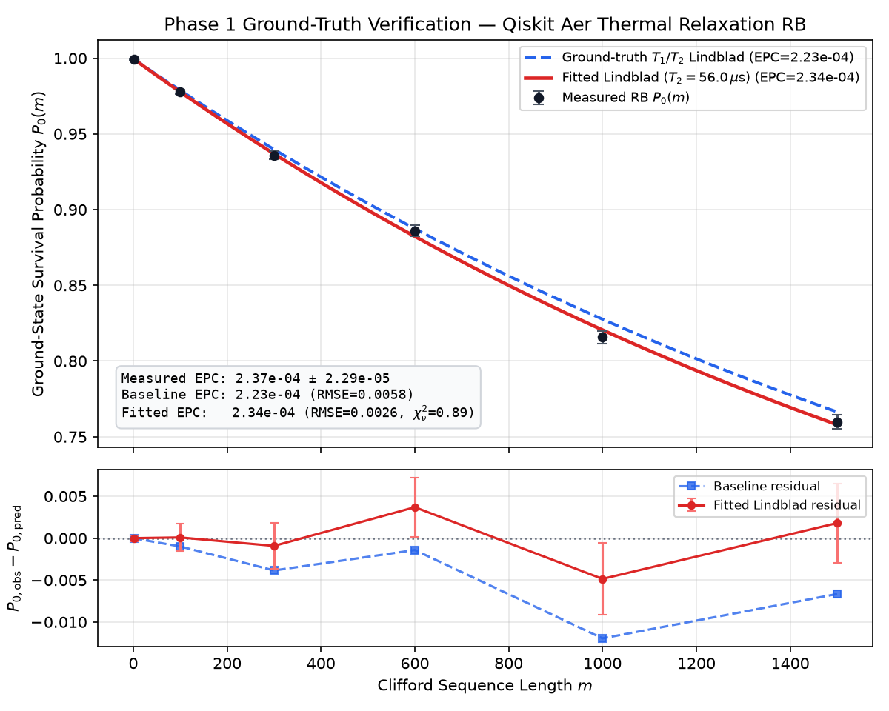

# Phase 1 Validation Report — Lindblad Noise Fitting & Hardware Benchmark

This report validates the QuTiP Lindblad RB calibration fitter (`qtwin.calibration.rb_model`) against both a synthetic ground-truth Qiskit Aer thermal-relaxation simulator and live IBM Quantum hardware.

## 1. Ground-Truth Verification (Qiskit Aer Dry-Run)

- **Backend:** `aer_thermal(T1=80.0us, T2=60.0us)` (Qubit `0`)
- **Source JSON:** `rb_1q_dry_run_aer_aer_thermal_q0_20261123T072839Z.json`
- **Job IDs:** `['34637444-649a-487f-8a0c-82c6c5858587']`
- **RB Settings:** lengths `[1, 100, 300, 600, 1000, 1500]`, samples `8`, shots `1024`
- **Effective Clifford Duration:** `29.15 ns` (`0.833` physical gates/Clifford × `35.0 ns`)
- **Reported Calibration:** $T_1 = 80.00\,\mu\text{s}$, $T_2 = 60.00\,\mu\text{s}$, `sx_err` = `None`, `readout_err` = `0.0`

| Model | $T_1$ ($\mu$s) | $T_2$ ($\mu$s) | Residual $\epsilon_{\mathrm{res}}$ | Predicted EPC | RMSE | Reduced $\chi^2_\nu$ |
| :--- | :---: | :---: | :---: | :---: | :---: | :---: |
| **Measured (Qiskit RB)** | — | — | — | 2.366e-04 ± 2.294e-05 | — | — |
| **Reported $T_1/T_2$ Lindblad Baseline** | 80.00 | 60.00 | 0 | 2.226e-04 | 0.00585 | 3.08 |
| **Fitted Lindblad (Effective $T_2$)** | 80.00 (fixed) | 55.96 ± 10.29 | 0 | 2.343e-04 | 0.00263 | 0.89 |
| **Fitted Lindblad ($T_1/T_2$ + Residual)** | 80.00 (fixed) | 60.00 (fixed) | 1.17e-05 ± 3.19e-05 | 2.343e-04 | 0.00263 | 0.89 |

## 2. Live IBM Quantum Hardware Benchmark (`ibm_fez`, Qubit 0)

- **Backend:** `ibm_fez` (Qubit `0`)
- **Source JSON:** `rb_1q_ibm_quantum_ibm_fez_q0_20261123T072913Z.json`
- **Job IDs:** `['dc1umd2nj2vs73dfstig']`
- **RB Settings:** lengths `[1, 20, 50, 100, 200, 350, 500]`, samples `5`, shots `1024`
- **Effective Clifford Duration:** `20.23 ns` (`0.843` physical gates/Clifford × `24.0 ns`)
- **Reported Calibration:** $T_1 = 56.77\,\mu\text{s}$, $T_2 = 49.63\,\mu\text{s}$, `sx_err` = `0.0016375797711712023`, `readout_err` = `0.0194091796875`

| Model | $T_1$ ($\mu$s) | $T_2$ ($\mu$s) | Residual $\epsilon_{\mathrm{res}}$ | Predicted EPC | RMSE | Reduced $\chi^2_\nu$ |
| :--- | :---: | :---: | :---: | :---: | :---: | :---: |
| **Measured (Qiskit RB)** | — | — | — | 1.176e-03 ± 1.749e-04 | — | — |
| **Reported $T_1/T_2$ Lindblad Baseline** | 56.77 | 49.63 | 0 | 1.952e-04 | 0.14688 | 377.46 |
| **Fitted Lindblad (Effective $T_2$)** | 56.77 (fixed) | 5.84 ± 1.39 | 0 | 1.212e-03 | 0.01000 | 2.14 |
| **Fitted Lindblad ($T_1/T_2$ + Residual)** | 56.77 (fixed) | 49.63 (fixed) | 1.02e-03 ± 2.74e-04 | 1.212e-03 | 0.01000 | 2.14 |

