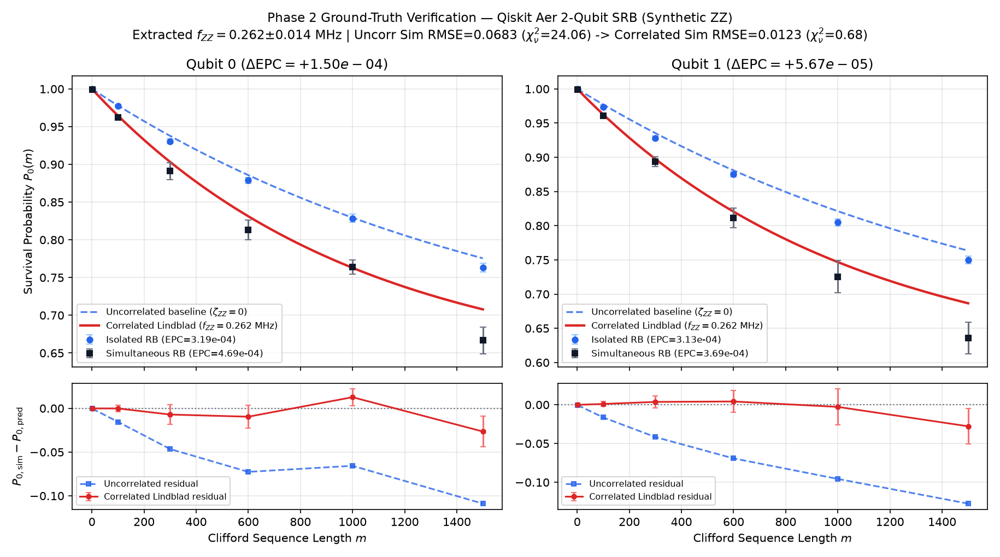

# Phase 2 Validation Report — 2-Qubit Simultaneous RB & Correlated ZZ Crosstalk

Validates the QuTiP 2-qubit Lindblad crosstalk fitter (`qtwin.calibration.crosstalk_model`) on synthetic Qiskit Aer ground truth and live IBM Quantum hardware.

## 1. Ground-Truth Verification (Qiskit Aer Dry-Run)

- **Backend:** `aer_zz(0.25MHz,T1=80/75us)` | **Qubit Pair:** `(0, 1)`
- **Source JSON:** `srb_2q_dry_run_aer_aer_zz_q0_1_20261123T074720Z.json` | **Job IDs:** `['3bc5a047-a642-4e57-9f42-ab056211a7bc']`
- **SRB Settings:** lengths `[1, 100, 300, 600, 1000, 1500]`, samples `8`, shots `1024`
- **Effective Clifford Duration:** `29.21 ns` (`0.834` phys gates/Clifford)
- **Reported Pair Calibration:** Q0 ($T_1=80.00\,\mu$s, $T_2=60.00\,\mu$s), Q1 ($T_1=75.00\,\mu$s, $T_2=55.00\,\mu$s)
- **Injected Ground-Truth $f_{ZZ}$:** `0.250 MHz`

### Measured Isolated vs. Simultaneous RB

| Qubit | $\mathrm{EPC}_{\mathrm{iso}}$ | $\mathrm{EPC}_{\mathrm{sim}}$ | $\Delta\mathrm{EPC} = \mathrm{EPC}_{\mathrm{sim}} - \mathrm{EPC}_{\mathrm{iso}}$ |
| :--- | :---: | :---: | :---: |
| **Q0** | 3.191e-04 ± 4.083e-05 | 4.692e-04 ± 8.845e-05 | `+1.500e-04` |
| **Q1** | 3.126e-04 ± 3.829e-05 | 3.693e-04 ± 7.818e-05 | `+5.672e-05` |

### Uncorrelated Baseline vs. Correlated 2-Qubit Lindblad Fit

| Model | Extracted $f_{ZZ}$ (MHz) | Pred $\Delta\mathrm{EPC}$ (Q0 / Q1) | Sim RMSE | Sim Reduced $\chi^2_\nu$ |
| :--- | :---: | :---: | :---: | :---: |
| **Uncorrelated Baseline ($f_{ZZ}=0$)** | `0.000` | `0 / 0` | `0.06834` | `24.06` |
| **Correlated Lindblad (`fit_zz`)** | 0.2617 ± 0.0138 | `+1.92e-04` / `+1.92e-04` | `0.01231` | `0.68` |

## 2. Live IBM Quantum Hardware Benchmark (`ibm_fez`, Pair `(0, 1)`)

- **Backend:** `ibm_fez` | **Qubit Pair:** `(0, 1)`
- **Source JSON:** `srb_2q_ibm_quantum_ibm_fez_q0_1_20261123T074844Z.json` | **Job IDs:** `['dc1uvb5hdvas73blcht0']`
- **SRB Settings:** lengths `[1, 20, 50, 100, 200, 350, 500]`, samples `5`, shots `1024`
- **Effective Clifford Duration:** `19.97 ns` (`0.832` phys gates/Clifford)
- **Reported Pair Calibration:** Q0 ($T_1=56.77\,\mu$s, $T_2=49.63\,\mu$s), Q1 ($T_1=206.27\,\mu$s, $T_2=251.26\,\mu$s)

### Measured Isolated vs. Simultaneous RB

| Qubit | $\mathrm{EPC}_{\mathrm{iso}}$ | $\mathrm{EPC}_{\mathrm{sim}}$ | $\Delta\mathrm{EPC} = \mathrm{EPC}_{\mathrm{sim}} - \mathrm{EPC}_{\mathrm{iso}}$ |
| :--- | :---: | :---: | :---: |
| **Q0** | 1.178e-03 ± 2.509e-04 | 1.444e-03 ± 2.066e-04 | `+2.663e-04` |
| **Q1** | 6.297e-04 ± 5.557e-04 | 6.824e-04 ± 4.705e-04 | `+5.267e-05` |

### Uncorrelated Baseline vs. Correlated 2-Qubit Lindblad Fit

| Model | Extracted $f_{ZZ}$ (MHz) | Pred $\Delta\mathrm{EPC}$ (Q0 / Q1) | Sim RMSE | Sim Reduced $\chi^2_\nu$ |
| :--- | :---: | :---: | :---: | :---: |
| **Uncorrelated Baseline ($f_{ZZ}=0$)** | `0.000` | `0 / 0` | `0.00978` | `2.47` |
| **Correlated Lindblad (`fit_zz`)** | 0.2864 ± 0.1036 | `+1.07e-04` / `+1.07e-04` | `0.00496` | `1.19` |

