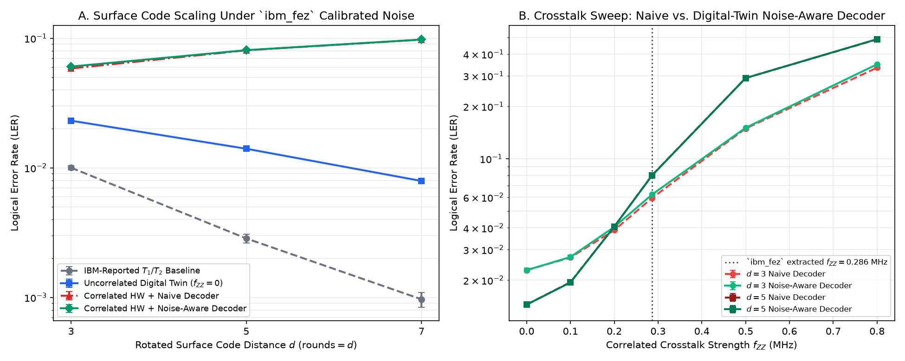

# Phase 3 QEC Validation Report — `ibm_fez` Digital Twin → Stim + PyMatching

## 1. Calibrated Physical Inputs & Pauli-Twirled Circuit Noise

- **Calibration Source:** `srb_2q_ibm_quantum_ibm_fez_q0_1_20261123T074844Z.json` (`ibm_fez` pair `(0, 1)` + Phase 1/2 fits)
- **Physical Parameters:** $T_1 = 131.52\,\mu$s, $T_2 = 150.44\,\mu$s, $\epsilon_{\mathrm{res}} = 1.02e-03$, $f_{ZZ} = 0.2864$ MHz, $t_{\mathrm{cycle}} = 0.10\,\mu$s
- **Derived Circuit Pauli Noise:** $p_X = p_Y = 6.996e-04$, $p_Z = 6.519e-04$, $p_{2q} = 3.310e-03$, $p_{\mathrm{meas}} = 2.026e-02$, $p_{IZ} = p_{ZI} = p_{ZZ} = 2.018e-03$

## 2. Four-Regime Rotated Surface Code Benchmark ($d \in \{3, 5, 7\}$, 60,000 shots/point)

| Regime | LER ($d=3$) | LER ($d=5$) | LER ($d=7$) | $\Lambda_{3\to 5}$ | $\Lambda_{5\to 7}$ |
| :--- | :---: | :---: | :---: | :---: | :---: |
| **IBM-Reported T_1/T_2 Baseline** | `1.0017e-02 ± 4.1e-04` | `2.8500e-03 ± 2.2e-04` | `9.6667e-04 ± 1.3e-04` | `3.51` | `2.95` |
| **Uncorrelated Digital Twin (f_{ZZ}=0)** | `2.3100e-02 ± 6.1e-04` | `1.4033e-02 ± 4.8e-04` | `7.9167e-03 ± 3.6e-04` | `1.65` | `1.77` |
| **Correlated HW + Naive Decoder** | `5.8450e-02 ± 9.6e-04` | `8.0733e-02 ± 1.1e-03` | `9.7550e-02 ± 1.2e-03` | `0.72` | `0.83` |
| **Correlated HW + Noise-Aware Decoder** | `6.0450e-02 ± 9.7e-04` | `8.0917e-02 ± 1.1e-03` | `9.7683e-02 ± 1.2e-03` | `0.75` | `0.83` |

## 3. Crosstalk Sweep: Naive vs. Digital-Twin Noise-Aware Decoder (60,000 shots/point)

| $f_{ZZ}$ (MHz) | $d=3$ Naive LER | $d=3$ Noise-Aware LER | $d=3$ LER Reduction | $d=5$ Naive LER | $d=5$ Noise-Aware LER | $d=5$ LER Reduction |
| :---: | :---: | :---: | :---: | :---: | :---: | :---: |
| `0.0000` | `2.2833e-02` | `2.2833e-02` | `+0.0%` | `1.4467e-02` | `1.4467e-02` | `+0.0%` |
| `0.1000` | `2.7017e-02` | `2.7183e-02` | `-0.6%` | `1.9467e-02` | `1.9400e-02` | `+0.3%` |
| `0.2000` | `3.8767e-02` | `4.0500e-02` | `-4.5%` | `4.0633e-02` | `4.0667e-02` | `-0.1%` |
| `0.2864` | `5.9450e-02` | `6.2217e-02` | `-4.7%` | `8.0383e-02` | `8.0200e-02` | `+0.2%` |
| `0.5000` | `1.4935e-01` | `1.5075e-01` | `-0.9%` | `2.9155e-01` | `2.9127e-01` | `+0.1%` |
| `0.8000` | `3.3402e-01` | `3.4953e-01` | `-4.6%` | `4.8670e-01` | `4.8782e-01` | `-0.2%` |

